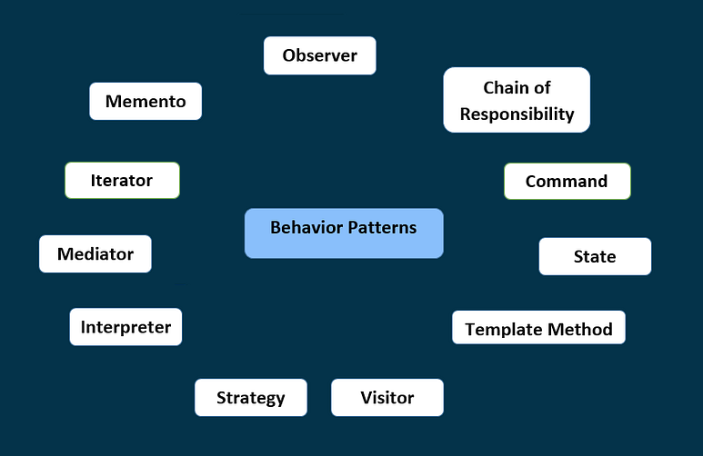

# Behavioral Design Patterns

  

## Overview
Behavioral design patterns are design patterns that identify common communication patterns among objects. By doing so, these patterns increase flexibility in carrying out this communication.
Behavioral patterns are those patterns that are concerned with the interaction between objects. The interaction between the objects should be in such a way that they are talking to each other and still are loosely coupled.

## Behavioral Design Patterns with Examples

1. [Iterator Design Pattern](./IteratorDesignPattern.md)
2. [Observer Design Pattern](./ObserverDesignPattern.md)
3. [Chain of Responsibility Design Pattern](./ChainofResponsibilityDesignPattern.md)
4. [State Design Pattern](./StateDesignPattern.md)
5. [Template Method Design Pattern](./TemplateMethodDesignPattern.md)
6. [Command Design Pattern](./CommandDesignPattern.md)
7. [Visitor Design Pattern](./VisitorDesignPattern.md)
8. [Strategy Design Pattern](./StrategyDesignPattern.md)
9. [Interpreter Design Pattern](./InterpreterDesignPattern.md)
10. [Mediator Design Pattern](./MediatorDesignPattern.md)
11. [Memento Design Pattern](./MementoDesignPattern.md)
