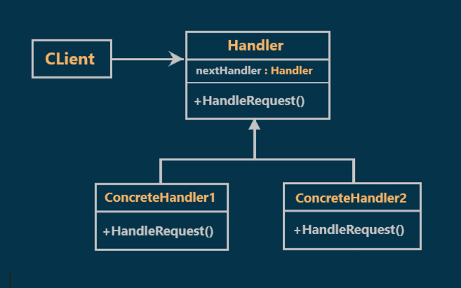
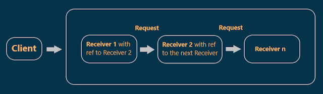
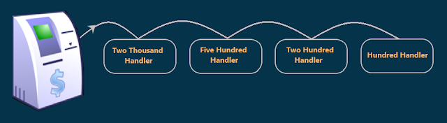
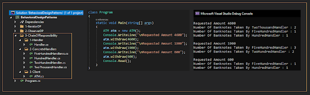

# Chain of Responsibility Design Pattern with an Example
## What is the Chain of Responsibility Design Pattern?
According to GOF Definitions, **"Avoid coupling the sender of a request to its receiver by giving more than one receiver object a chance to handle the request. Chain the receiving objects and pass the request along the chain until an object handle it"**.    

In simple words, we can say that the chain of responsibility design pattern creates a chain of receiver objects for a given request. each receiver object contains a reference to another receiver. If one receiver cannot handle the request then it passes the same request to the next receiver and so on.  

Sometimes one receiver is enough to handle the request in the chain and other times we need more than one receiver to handle the request.
## Class Diagram of Chain of Responsibility Design Pattern:

  

## Understanding the Chain of Responsibility Design Pattern:

  

As shown in the above diagram, on the left side we have a client and on the right side, we have multiple receivers chained together (**Receiver 1** has a reference to **Receiver 2** and receiver 2 has a reference to the **Next Receiver** and so on).   

the client sends the request to the Chain of Receivers. the request will come first to **Receiver 1** which will check whether it can handle the request or not, If **Receiver 1** can handle it then it will do and then check whether further processing is needed or not. If further processing is needed then it will send the request to the **Next Receiver** in the chain of receivers and so on, if no need for further processing, it will not pass the request to the next receiver.
## Understanding Chain of Responsibility Design Pattern with an example:

  

look at the above figure. we have an ATM machine and we have four handlers.  

The `TwoThousandhandler` will give banknotes of type 2000. Similarly, the `FiveHundredHandler` will give banknotes of type 500 and the same for 200 and 100 handlers.  

suppose that Mohamed wants to **withdraw 4600** from the ATM machine. So, what the ATM machine here will do is, send the request to the first handler i.e. the `TwoThousandHandler`, and the `TwoThousandHandler` will check the amount and give **two banknotes of type 2000** and then the remaining is 600. So, the `TwoThousandHandler` will send the request to the `FiveHundredHandler` and the `FiveHundredHandler` will check the remaining amount and will give **one banknote of type 500** and the remaining is 100. So, the `FiveHundredHandler` will forward the request to the next handler i.e. `TwoHundredHandler` and the `TwoHundredHandler` will check the remaining amount which is 100. So, it can't handle the request and it simply forwards the request to the next handler which is `HundredHandler`. The `HundredHandler` checks the remaining amount which is 100 and will give **one banknote of type 100**. In this way, it will handle the request and provide **4600 (2 * 2000, 1 * 500, and 1 * 100)** to Mohamed.

## Implementation:

  

