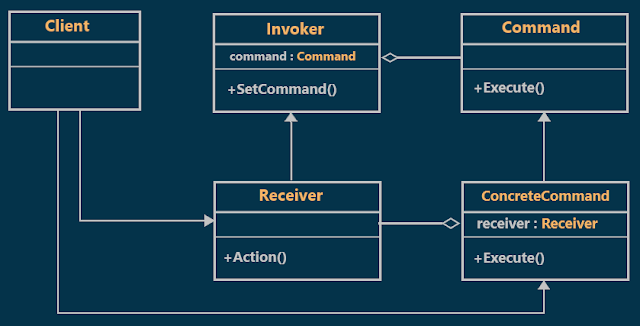
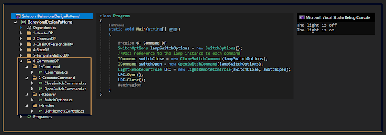

# What is the Command Design Pattern?
## What is the Command Design Pattern?
Command Design Pattern is used to encapsulate a request as an object (command) and pass it to an invoker, wherein the invoker does not know how to serve the request but uses the encapsulated command to perform an action.
## Class Diagram of Command Design Pattern:

  

## Understanding Command Design Pattern with an Example :
Suppose we have a lamp **(Receiver)** that works by remote control (Invoker) this remote control has two **commands (open and close)** when we press open the lamp will be on, similarity when we press close the lamp will be off
## Implementation:

  

## When to use Command Design Pattern in Real-time Application?
**Flexibility**: The pattern allows you to add new commands or change existing ones without modifying the client code.
Transactional Behavior: When implementing transactional behavior a series of actions need to be treated as a single atomic operation. The Command pattern can help in implementing such requirements.  

**Undo/Redo functionality**: By encapsulating a command as an object, it becomes easier to implement undo and redo operations. Each command object can store information about its execution, making it possible to reverse or repeat actions.  

**Testing**: Command objects make it easier to write tests since you can isolate the logic encapsulated within each command.
