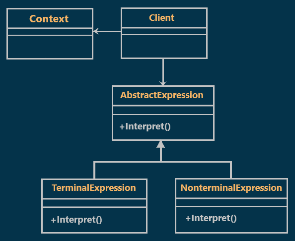
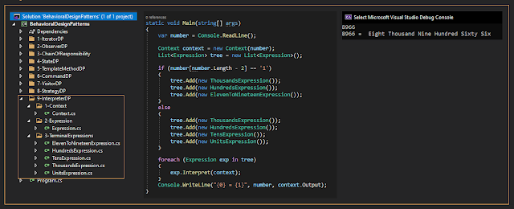

# Interpreter Design Pattern with an Example
What is the Interpreter Design Pattern?
According to GOF Interpreter Design Pattern "**defines a representation for its grammar along with an interpreter that uses the representation to interpret sentences in the language.**"  

## Class Diagram of Interpreter Design Pattern:

  

## Understanding Interpreter Design Pattern with an example :
Sometimes we need to convert numbers to words. in our example we will
apply the interpreter Design pattern to Convert numbers to words.

### Notes
1. I supposed that the max number consists only of four digits
2. No fractions

## Implementation:

  

