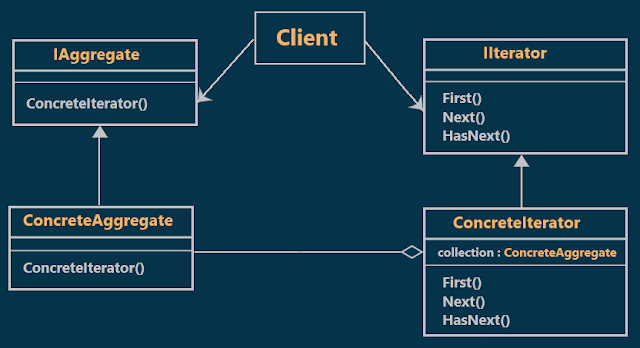
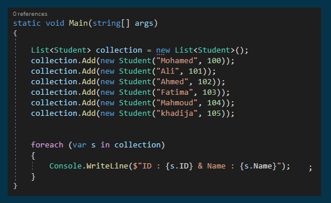
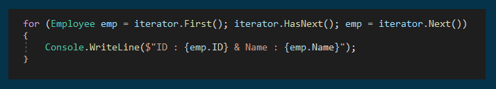
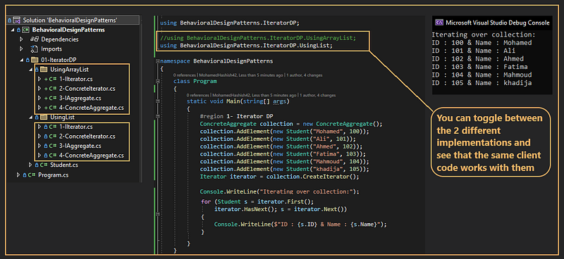

# Iterator Design Pattern with an Example
## What is Iterator Design Pattern?
The Iterator Design Pattern allows sequential access of elements without exposing the inside logic. That means using the Iterator Design Pattern we can access the elements of a collection object in a sequential manner without any need to know its internal representations. 
### Example from daily life
Remote control of the TV is an example of iterators in our daily life. just pick up the TV remote control and start pressing Up and Down keys to iterate through the channels.
## Class Diagram of Iterator Design Pattern:

  

## Understanding the Iterator Design Pattern with an Example
Suppose we have a collection of employees. Then we can easily iterate through the collection using either for or for each loop as shown below:  

  

in the previous code, the for-each loop sequentially accessing the elements from the collection without exposing the internal logic. but if you want to use a different data structure then you need to change the client code. instead of that, it is better to provide a uniform interface for iterating through different collections.  

For example, you may have different types of collections in your application such as List, Array, ArrayList, Dictionary, etc. For whichever type of collection you have, you will need to iterate through the items in the collections. The actual implementation of how to iterate different types of collections will be different, yet the client code should not be concerned about the details of the implementations. **The Iterator Design Pattern helps you to hide such details and provides a generic interface for the client to traverse different types of collections as shown in the below image.**

  

## Implementation:

  

## Why do we need to use the Iterator Design Pattern?
The Iterator Design Pattern allows us to access the elements of a collection without exposing its internal data structure. That means it allows you to navigate through a different collection of data using a common interface without knowing about their underlying implementation.
