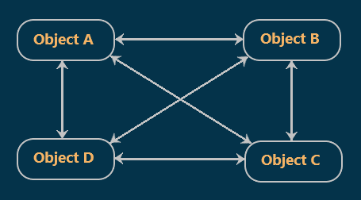
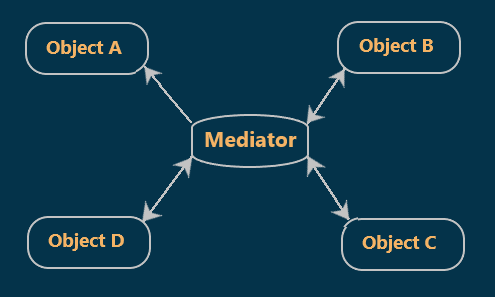
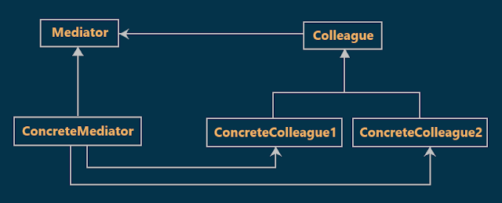
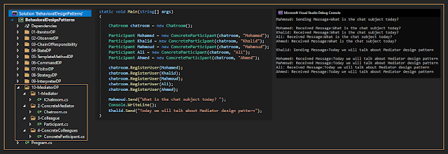

# Mediator Design Pattern with an Example
## What is the Mediator Design Pattern?
According to the Gang of Four's definition, Mediator Design Pattern **"defines an object that encapsulates how a set of objects interact. Mediator promotes loose coupling by keeping objects from referring to each other explicitly, and it lets you vary their interaction independently."**

### Simplification of the above GoF definition:
The Mediator Design Pattern is used to reduce the communication complexity between multiple objects. This design pattern provides a mediator object and that mediator object normally handles all the communication complexities between different objects. The Mediator object acts as the communication center for all objects. That means when an object needs to communicate with another object, then it does not call the other object directly, instead, it calls the mediator object and it is the responsibility of the mediator object to route the message to the destination object.
## Why do we need the Mediator Pattern?
Suppose we have four objects (Object A, Object B, Object C, and Object D).
And these four objects want to communicate with each other.  

without the mediator If two objects want to communicate with each other, they should have references to each other for example if Object A wants to send some message to Object B, then it should know the reference of Object B, and using that reference it will call the methods of Object B and sends the message. for a more understanding look at the following diagram :

  

As you see in the Previous diagram the couplings between the objects are tight coupling which means A lot of objects depend on each other.  

To solve the above program we can use the Mediator object. Each object has to send messages to the mediator object. What the mediator object do here is receiving the message from each object and route that message to the destination object. So, the mediator object will take care of handling the messages.
For a more understanding look at the following diagram

  

## Class Diagram of Mediator Design Pattern:

  

## Understanding Mediator Design Pattern with an example :
We will write simple code that simulates the chatroom, the Chatroom will represent the central hub (mediator) through which all communication between participants takes place.
## Implementation:

  

