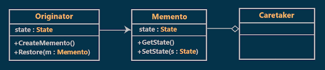
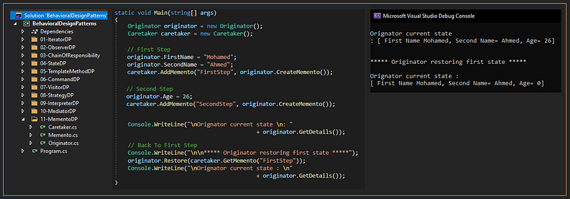

# Memento Design Pattern with an Example
## What is the Memento Design Pattern?
The Memento Design Pattern is used to restore an object to its previous state. That means if you want to perform some kind of undo or rollback operation in your application then you need to use the Memento Design Pattern.
## Class Diagram of the Memento Design Pattern:

  

### Originator
- creates a memento containing a snapshot of its current internal state.
- uses the memento to restore its internal state
### Memento
- stores the internal state of the Originator object.
### Caretaker
- is responsible for the memento's safekeeping
- never operates on the contents of a memento.
## Understanding Memento Design Pattern with an example :
Suppose that the user's information needed to register to a site is (First Name, Second Name, Age) and this information is being entered in different steps what we need to do is to allow the user to go back and edit his information in any previous step without losing its state. for example, the user in the first step will enter the first name and the second name then the age in the second step. if he wants to edit his first name he should go back to the first step.
## Implementation:

  

