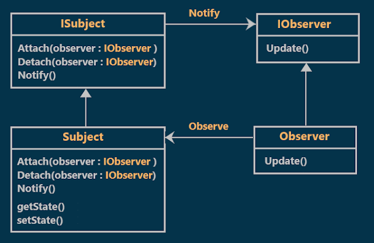
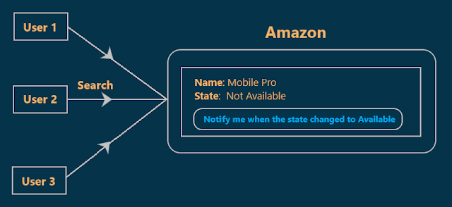
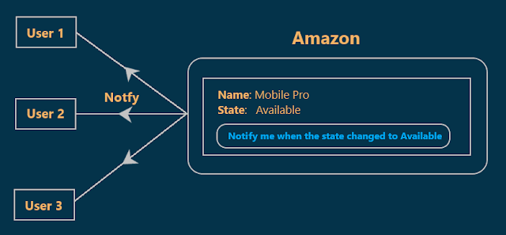
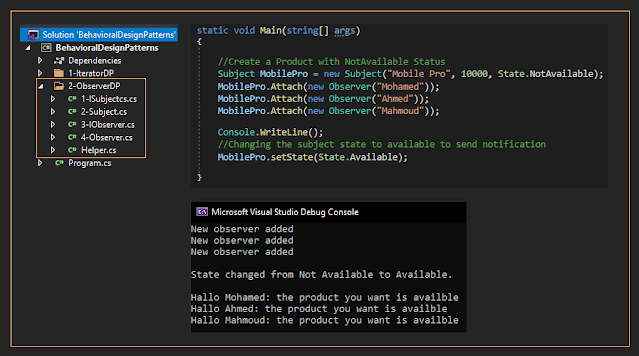

# Observer Design Pattern with an Example
## What is the Observer Design Pattern?
According to GoF, the Observer design Pattern should **"Define a one-to-many dependency between objects so that when one object changes state, all its dependents are notified and updated automatically"**.
## Class Diagram of Observer Design Pattern:

  

As we see in the class diagram the observer design pattern has two main components:
### 1- Subject:
They are the publishers. When a change occurs to a subject it should notify all of its subscribers.
### 2- Observers:
They are the subscribers. They simply listen to the changes in the subjects.
## Understanding observer Design Pattern with an example :
Suppose that three users came to the Amazon site for buying a Mobile Phone and all of them want the same mobile type **(MobilePro)**, but Unfortunately, at that time the state of this type was **Not Available**.  

Suppose that Amazon site provides an option called **notify me when the product state changed to Available** and the above three users attached themselves to this option.  

In our examples, the **MobilePro** is the **Subject** and three users **(User1, User2, and User3)** are the **Observers**. For a better understanding look at the next two diagrams.  

  
  

## Implementation:

  

