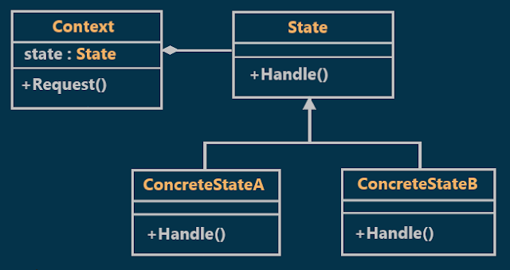
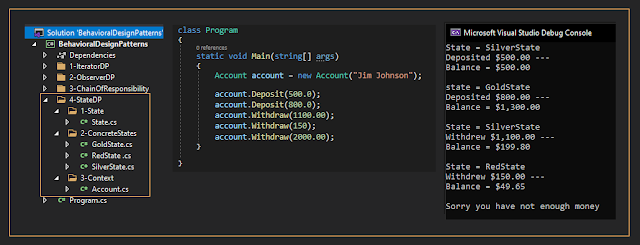

# State Design Pattern with an Example
## What is the State Design Pattern?
According to Gang of Four Definitions, the State Design Pattern **"allows an object to alter its behavior when its internal state changes"** 
    
In simple words, we can say that the State Pattern is a design pattern that allows an object to completely change its behavior depending upon its current internal state.

## Class Diagram of State Design Pattern:

  

## Understanding the State Design Pattern with an Example:
let's assume that a bank Account behaves differently depending on the balance state which may be (Red State, Silver State, or Gold State)  

**Red State** means overdrawn account  
**Silver State** means starter account    
**Gold State** means an account in good standing    

🟥 Red State
- **Balance Range:** `0.0 → 100.0`
- **Service Fee:** `0.05`

⬜ Silver State
- **Balance Range:** `101.0 → 1000`
- **Service Fee:** `0.15`

🟨 Gold State
- **Balance Range:** `1001 → 10,000,000.0`
- **Service Fee:** `0.20`

## Implementation:

  

