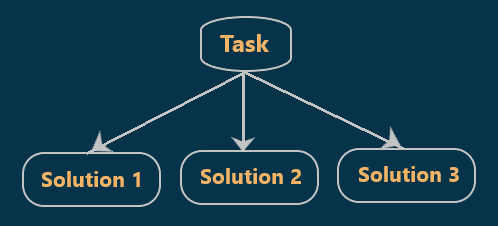
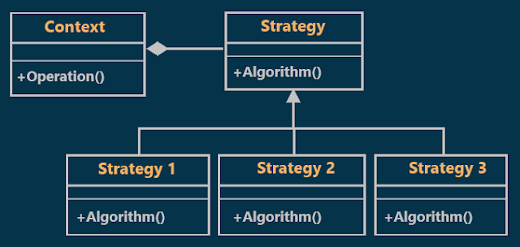
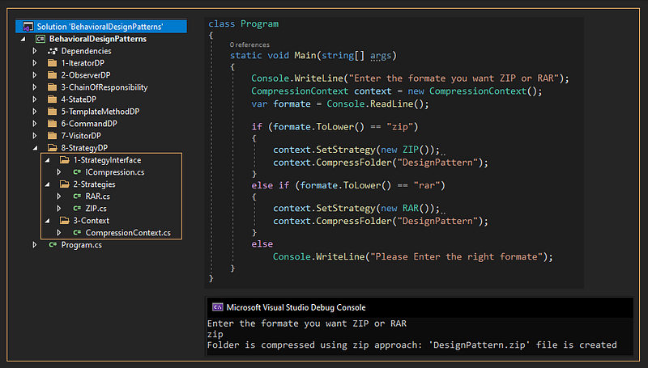

# Strategy Design Pattern with an Example
## What is the Strategy Design Pattern?
According to Gang of Four Definitions, Strategy Design Pattern "**defines a family of algorithms, encapsulates each one, and makes them interchangeable. Strategy lets the algorithm vary independently from clients that use it.**."  

The Strategy Design Pattern is used when we have multiple algorithms (solutions) for a specific task and the client selects the actual implementation to be used at runtime.

  

## Class Diagram of Strategy Design Pattern :

  

## Understanding strategy Design Pattern with an Example :
Suppose we want to design a program that allows us to compress a specific folder into ZIP or RAR formats, here we have two strategies ZIP and RAR. The two strategies are related to the same family of algorithms i.e (compression)
## Implementation:

  

## What is the advantage of the Strategy Design Pattern?
1. You can swap algorithms used inside an object at runtime.
2. You can isolate the implementation details of an algorithm from the code that uses it.
3. Open/Closed Principle. You can introduce new strategies without having to change the context.
## What is the disadvantage of the Strategy Design Pattern?
Clients must be aware of the differences between strategies to be able to select a proper one.
