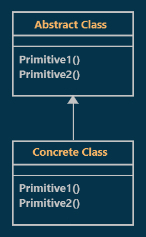
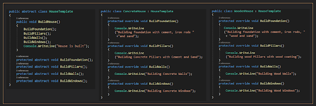

# Template Method Design Pattern with an Example
## What is the Template Method Design Pattern?
According to Gang of Four Definitions, The Template Method Design Pattern **"Define the skeleton of an algorithm in an operation, deferring some steps to subclasses. Template Method lets subclasses redefine certain steps of an algorithm without changing the algorithm's structure"**  

In other words, **it defines a sequence of steps of an algorithm and allows the subclasses to override the steps but don't allowed to change the **sequence**. The Key to the Template Design Pattern is that we put the general logic in the abstract parent class and let the child classes define the specifics.

## Class Diagram of Template Method Design Pattern:

  

## Understanding Method Design Pattern With an Example:
Suppose you want to build a **concrete house**, then you need to follow a sequence of steps such as
**First**, you need to build a foundation.  
**Second**, you need to build Pillars.  
**Third**, you need to build Walls.  
**finally**, you need to build Windows.  

Also if you want to build a **wooden house**. Then also you need to follow the same sequence of procedures that you follow in order to build a concrete house 
**First**, you need to build a foundation.  
**Second**, you need to build Pillars.  
**Third**, you need to build Walls.  
**finally**, you need to build Windows.  

The only difference here is instead of using Concrete you need to use Wooden Materials. So, what you can do here is, you can define a template method called `BuildHouse`. The template method will define what are all the procedures or steps that you need to follow in order to build a house.

## Implementation:

  

