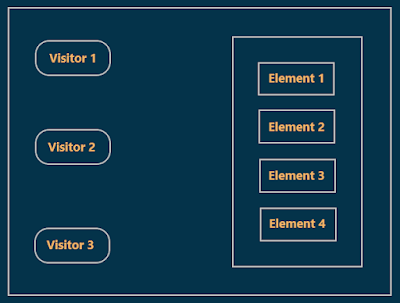
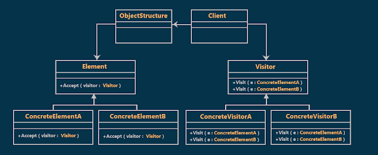
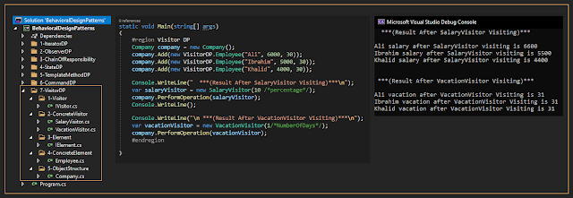

# Visitor Design Pattern with an Example
## What is the Visitor Design Pattern?
Represent an operation to be performed on the elements of an object structure.
Visitor lets you define a new operation without changing the classes of the elements on which it operates.  

To understand the above explanation better, look at the following diagram  

  

The left-hand side represents visitor objects and the right-hand side represents the object structure.  

The object structure can be a collection of the type either Array, List, ArrayList, etc. As you can see and can have multiple elements **(Element 1, Element 2, Element 3, and Element 4)**.  

Now if you want to perform some common operation on each element, then you need to use the visitor design pattern.  

Here, the Visitor object will visit each element of the object structure and perform the common operation.  

Now it is possible to vary the operation as the visitor varies. For example, for **Visitor 1**, you may perform **operation A** on each element whereas, for **Visitor 2**, you may perform **operation B** on each element
## Class Diagram of Visitor Design Pattern:

  

## Understanding Visitor Design Pattern with an example :
Suppose we have a company and this company has a list of employees, and we want to design a program that allows us to modify the salary or the vacation of all list of employees. we will use the visitor design pattern to implement this program.  

in our example, we have two visitors one for the salary and another one for the vacation, and our object structure is the list of employees.
## Implementation:

  

## The advantage of the Visitor design pattern
1. Allows you to add operations to an Object Structure without changing the
structure itself.
2. Make the primary classes of your app more focused on their main jobs by extracting all other behaviors into a set of visitor classes.
## When to use Visitor Design Pattern?
When you need to perform an operation on all elements of a complex object structure.