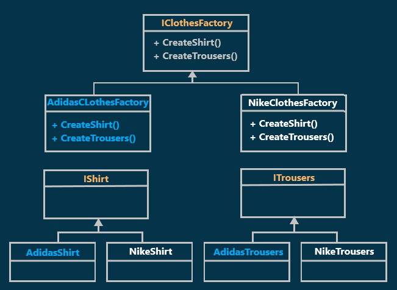
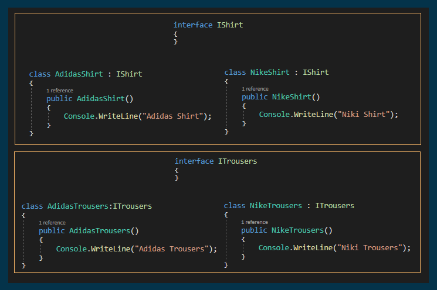
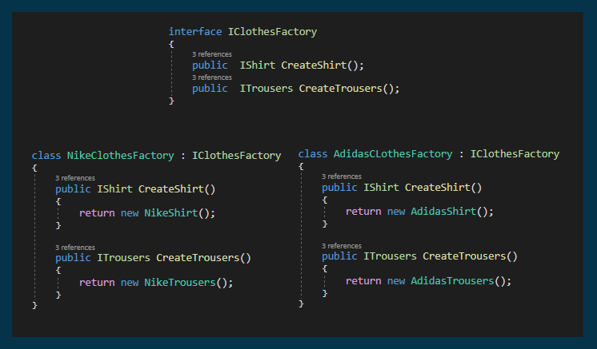
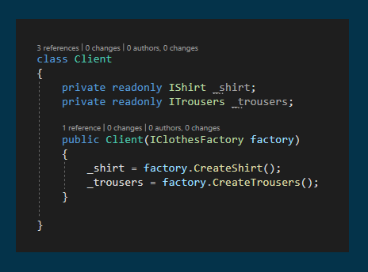
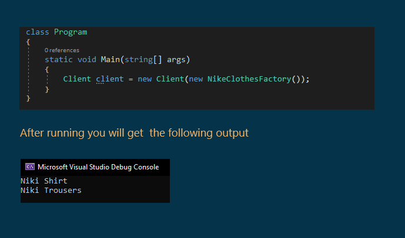

# Abstract Factory Design Pattern with an Example
## What is Abstract Factory Design Pattern?
According to Gang of Four Definition: "The Abstract Factory Design Pattern provides a way to encapsulate a group of individual factories that have a common theme without specifying their concrete classes".

## Understanding Abstract Factory Design Pattern with an Example:

  

let's assume we have a clothes factory that sells products of two brands (Nike and Adidas) and as we know both two brands have shirts and trousers and as per definition we can consider shirts and trousers as the common theme between the two brands
The Class Diagram of Abstract Factory Design Pattern Depending on our example:
## Implementation

  
  
  
  

