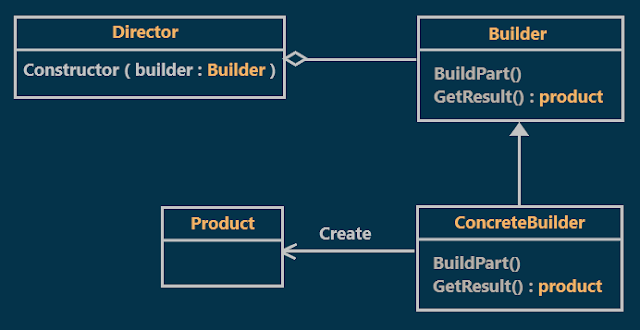
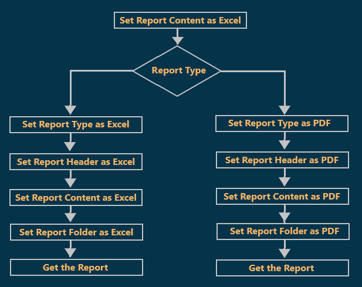
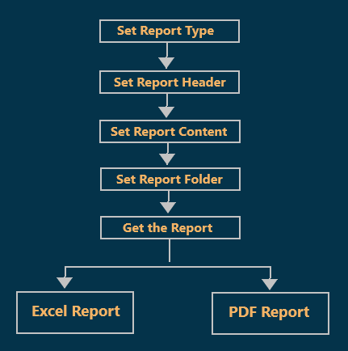
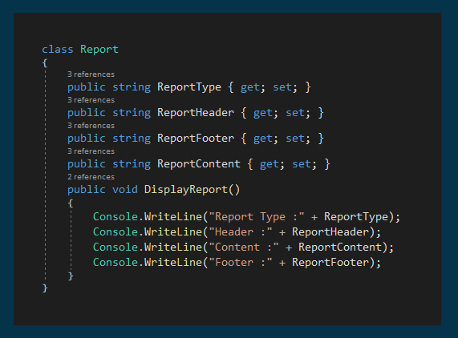
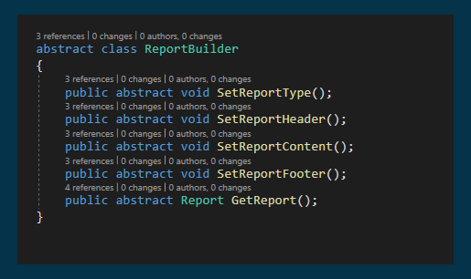
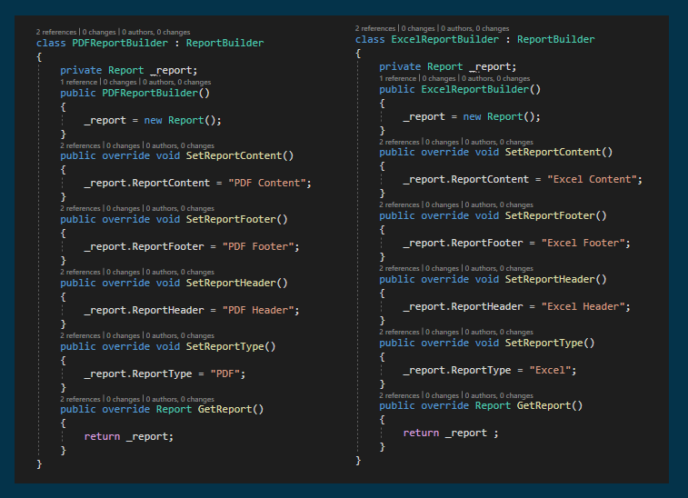
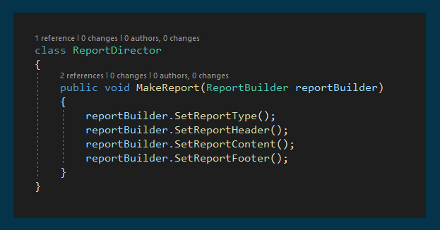
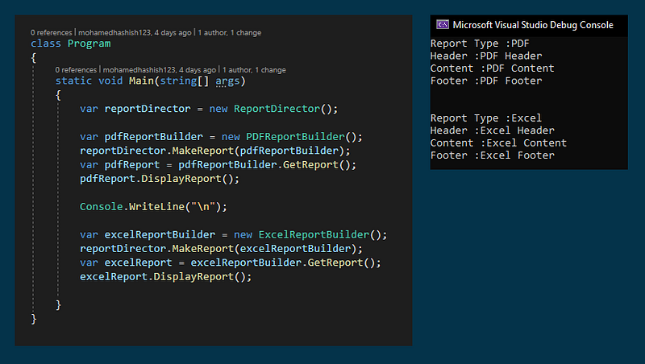

# Builder Design Pattern with an Example
## What is Builder Design Pattern?
According to the Gang of Four's definition, Builder Design Pattern "Separate the construction of a complex object from its representation so that the same construction process can create different representations."
## Class Diagram of Builder Design Pattern:

  

As you see in the class diagram in order to separate the construction process from its representation, the builder design pattern Involves four components:
### Product:
This is a class that defines the parts of the complex object which are to be generated by the builder pattern.
### Builder:
This is an interface or abstract class which is used to define all the steps to create a product
### ConcreteBuilder:
This is a class that implements the Builder interface or abstract class to create a complex product.
### Director:
This is a class that is used to construct an object using the Builder interface.
## Understanding the Builder Design Pattern with an Example:
Let us understand the builder design pattern with one real-time example. Suppose we want to develop an application for displaying the reports. The reports we need to display either in Excel or in PDF format. That means, we have two types of representation of my reports. In order to understand this better, look at the following diagram.

  

As you can see, in the above image, we are generating the report either in Excel or PDF. but in the following diagram, the construction process involves several steps such as 
- Creating a new report 
- Setting the report type, 
- Setting the header 
- Setting the content
- Setting the footer 
   
If you look at the final output you will find that we have one Two representation 
- PDF report
- Excel report

  

## Implementation:

  
  
  
  
  

## Abstract Factory vs Builder design pattern:
**Abstract Factory**: Emphasizes a family of product objects (either simple or complex).  
**Builder**: Focuses on constructing a complex object step by step.  

**Abstract Factory**: Focus on **what** is made.  
**Builder:** Focus on **how** it is made.  

**Abstract Factory**: Focus on defining **many** different types of factories to build many products, and it is not one builder for just one product.  
**Builder**: Focus on building **one** complex product.  

**Abstract Factory**: **Every** method call creates and returns different objects.  
**Builder**: Only the **last** method call returns the object, while other calls partially build the object.  
