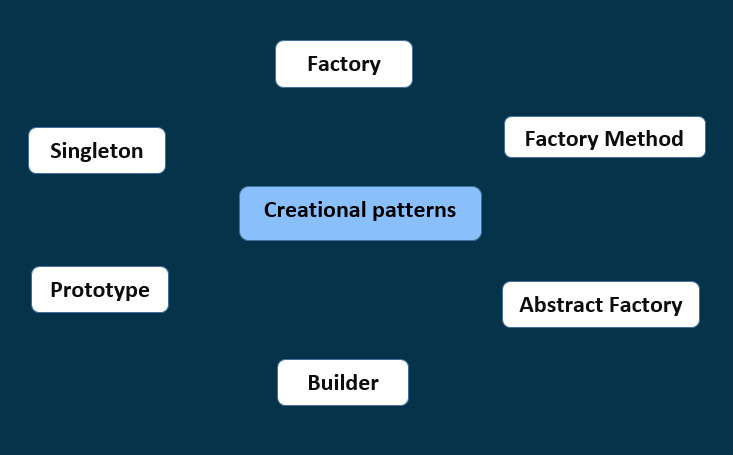

# Creational Design Patterns

  

## Overview
According to [Wikipedia](https://en.wikipedia.org/wiki/Creational_pattern), in software engineering, creational design patterns are design patterns that deal with object creation mechanisms, meaning they try to create objects in a manner that is suitable to a given situation. 

In simple words, we can say that the Creational Design Pattern deals with Object Creation and Initialization.   
This Design Pattern gives the programmer more flexibility in deciding which objects need to be created for a given situation.

## Creational Design Patterns with Examples

1- [Factory Design Pattern](./FactoryDesignPattern.md)  
2- [Factory Method Design Pattern](./FactoryMethodDesignPattern.md)  
3- [Abstract Factory Design Pattern](./AbstractFactoryDesignPattern.md)  
4- [Builder Design Pattern](./BuilderDesignPattern.md)  
5- [Prototype Design Pattern](./PrototypeDesignPattern.md)  
6- [Singleton Design Pattern](./SingletonDesignPattern.md)
