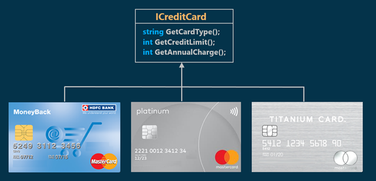
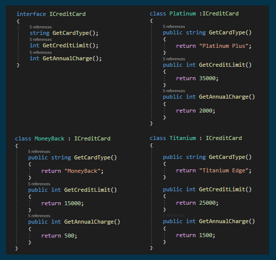
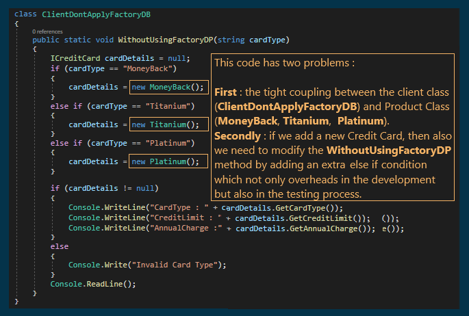
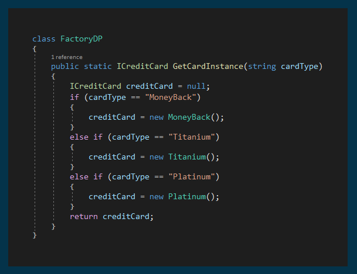
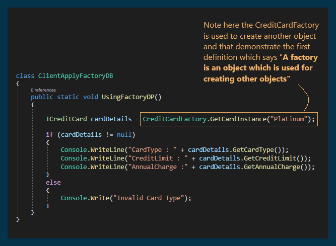

# Factory Design Pattern with an Example

## What is Factory Design Pattern?
The Factory Pattern centralizes object creation in a single place. Instead of creating objects directly using constructors, a factory method decides which object to create based on input parameters.

**Key Idea:** Creation logic is handled inside one class using conditional logic (e.g., if / switch).

### When to use

- When the type of object depends on runtime input
- When you want to hide object creation details from the client

## Understanding the Factory Design Pattern with an Example

Let's assume we have three classes (`MoneyBack`, `Titanium`, `Platinum`)  
All of them implement an interface called `ICreditCard`.  

  

Our requirement is to get the right object (`MoneyBack`, `Titanium`, `Platinum`) when passing a specific parameter.

## Implementation

  

## Solving the example without using the Factory Design Pattern

  

## Solving the example using the Factory Design Pattern

  
  

### Problems of Simple Factory Pattern

1. If we need to add any new product (i.e., new credit card), then we need to add a new `if-else` condition in the `GetCardInstance` method of the `CreditCardFactory` class. This violates the Open/Closed design principle.
2. We also have a tight coupling between the Factory (`CreditCardFactory`) class and product classes (`MoneyBack`, `Titanium`, and `Platinum`).  

To overcome the above problems, we need to use the  [Factory Method Design Pattern](./FactoryMethodDesignPattern.md) .
