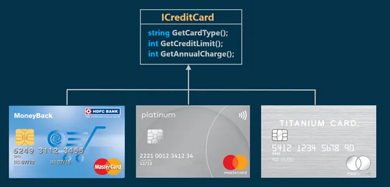
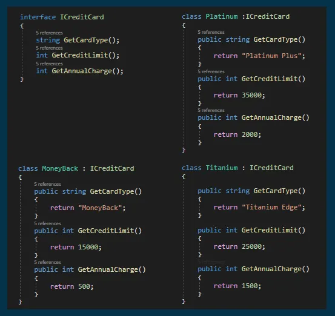
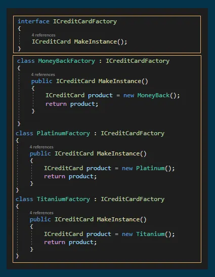
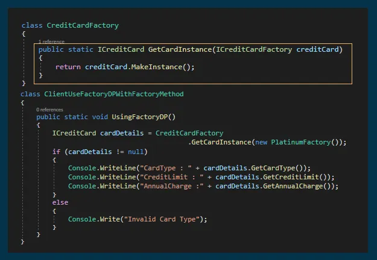

# Factory Method Design Pattern with an Example

## Note
To understand this pattern, please first read [Factory Design Pattern](./FactoryDesignPattern.md)

## What is Factory Method Design Pattern?

The Factory Method Pattern defines a common interface for object creation, but allows subclasses to decide which concrete class to instantiate.

**Key Idea:** Creation logic is delegated to subclasses instead of being handled in a single class.

### When to use

- When a class cannot know which objects it needs to create  
- When you want to follow the Open/Closed Principle (extend without modifying existing code)

### 🔍 Difference Between Factory and Factory Method

- **Factory Pattern:** uses conditional logic inside one class to decide which object to create  
- **Factory Method Pattern:** moves the creation responsibility to subclasses, eliminating conditional logic  

## Understanding the Factory Method Design Pattern with an Example

Let's assume we have three classes (`MoneyBack`, `Titanium`, `Platinum`) and all of them implement an interface called `ICreditCard`.

  

According to the pattern definition, we need to create an interface for object creation.

In this example:
- We create an interface `ICreditCardFactory` with a method called `MakeInstance`.
- We create three factory classes:
  - `MoneyBackFactory`
  - `TitaniumFactory`
  - `PlatinumFactory`

Each factory implements `ICreditCardFactory`.

The goal is to make the client depend on the factory interface instead of concrete classes.

## Implementation

  
  

## Enhancing Factory Pattern Using Factory Method

  

As shown in the previous figure:

1. If we need to add a new product (i.e., a new credit card), we no longer modify existing code.  
   Instead, we create a new factory that implements `ICreditCardFactory`.  
   (This achieves the Open/Closed Principle.)

2. There is no longer tight coupling between the factory (`CreditCardFactory`) and the product classes (`MoneyBack`, `Titanium`, `Platinum`).