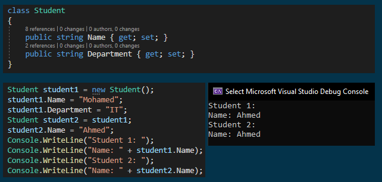
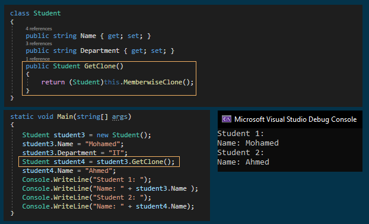

# Prototype Design Pattern with an Example
## What is the Prototype Design Pattern?
As per the Gang of Four Definition, "Prototype Design Pattern specifies the kind of objects to create using a prototypical instance, 
and create new objects by copying this prototype".
  
To simplify the above definition, we can say that, the Prototype Design Pattern gives us a way to create new objects from the existing instance of the object. That means it clones the existing object with its data into a new object. If we do any changes to the cloned object then it does not affect the original object.
## Understanding the Prototype Design Pattern in C#:
In C#, when we try to copy one object to another object using the assignment (=) operator, then both objects will share the same memory address. And the reason is the assignment operator (=) copy 
the reference, not the object except when there is a value type field.
Please have a look at the following image.

  

## Understanding Object Cloning:
When we talk about object cloning it means it is all about the call by value. So, if we do any changes to one object then it will not affect the other object. C# provides one method i.e. MemberwiseClone to clone an object which will create a new complete copy of the object. Please have a look at the following image.

  

