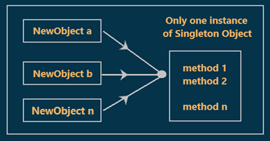
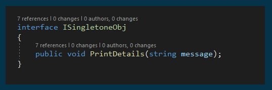
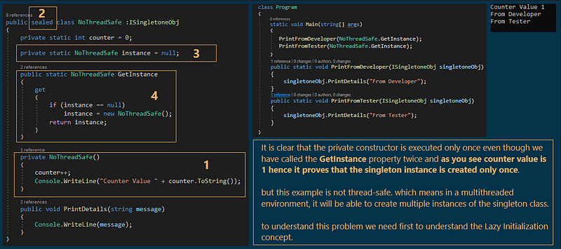
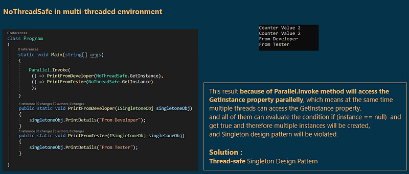
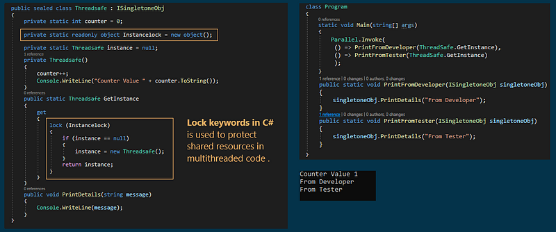
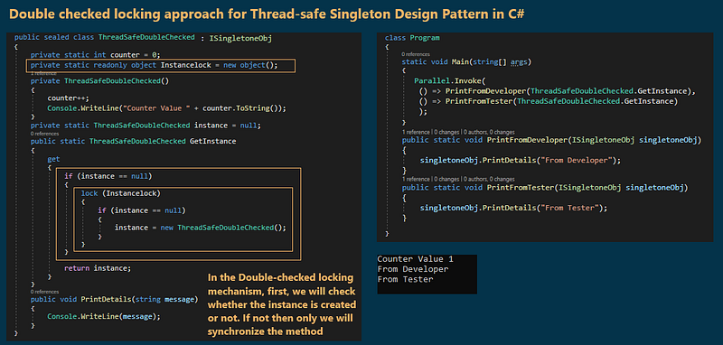
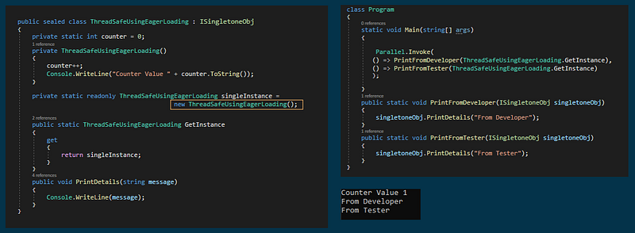
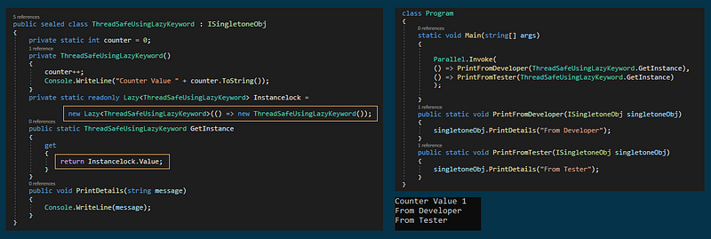

# Singleton design pattern with an Example
## What is Singleton design pattern?
Singleton is a Design Pattern that ensures that only one instance of a particular class is going to be created and then provide simple global access to that instance for the entire application.

<p align="center">
  
</p>

As you can see in the above diagram, different clients `(NewObject a, NewObject b, and NewObject n)` trying to get the singleton instance. Once the client gets the singleton instance then they can invoke the methods `(Method 1, Method 2, and Method n)` using the same instance.
## What are the Advantages of using the Singleton Pattern?
1. It takes care of concurrent access to the shared resource. That means if we are sharing a resource with multiple clients simultaneously, the singleton design pattern will provide well-managed concurrent access to that resource.
2. It can be lazy-loaded and also has Static Initialization.
3. To share common data i.e. master data and configuration data that is not changed that frequently in an application. In that case, we need to cache the objects in memory.
4. It provides a single global point of access to a particular instance, so it is easy to maintain.
5. It reduces the overhead of instantiating a heavy object again and again
## What are the Disadvantages of using the Singleton Design Pattern?
1. Unit testing is very difficult because it introduces a global state into an application.
2. It reduces the potential for parallelism within a program because to access the singleton instance in a multi-threaded environment, you need to serialize the object by using locking.

## How to implement the Singleton Design Pattern in C#
There are many ways, we can implement the Singleton Design Pattern in C# are as follows :
1. **No Thread-Safe** Singleton design pattern.
2. **The Thread-Safe** Singleton Design pattern implementation using Locking.
3. **Thread-Safe Singleton** Design pattern using Eager loading.
4. **Using .NET 4's `Lazy<T>` type**.
## Implementation guidelines for using the singleton in C#:
1. you need to declare a constructor that should be **private** and **parameterless**. this is required because it is not allowed for the class to be instantiated from outside the class. It is only instantiated from within the class.  
   
2. The class should be declared as **sealed** which will ensure that it cannot be inherited. This is going to be useful when you are dealing with the nested class.
   
3. Need to create a private **static variable** that is going to hold a reference to the single created instance of the class.
   
4. You also need to create a public **static property/method** which will return the single created instance. This method or property first checks if an instance of the singleton class is available or not. If the singleton instance is available, then it returns that singleton instance otherwise it will create an instance and then return that instance.  

**Note**  
I have added the following interface to all singleton classes just for reusing `PrintFromDeveloper` and `PrintFromTester` methods

<p align="center">
  
</p>

---

### **1- No Thread-Safe Singleton Design Pattern**
This means in a multithreaded environment, it will be able to create multiple instances of the singleton class.  

<p align="center">
  
</p>


#### **What is Lazy Initialization in the Singleton Design Pattern?**
In the previous example, **the NoThreadSafe instance is not created until we invoke the GetInstance**, this delay of Singleton Instance creation is called Lazy Initialization( on-demand object creation of the NoThreadSafe).


**Important Note**  
The on-demand object creation of the singleton class works fine when we invoke the GetInstance property in a Single-threaded environment.
But in a multi-threaded environment, it will not work as expected. In a multi-thread environment, the lazy initialization may end up creating multiple instances of the singleton class.
To understand this note, look at the following figure.


<p align="center">
  
</p>

---

### **2-Thread-safe Singleton Design Pattern using Lock keywords in C#:**
<p align="center">
  
  
</p>

---

### **3- Thread-safe using Eager loading**
#### What is Eager Loading in C#?
The Eager loading in singleton design pattern is a process in which we initialize the singleton object at the time of application start-up rather than on-demand and keep it ready in memory to be used in the future.  

The advantage of using Eager Loading in the Singleton design pattern is that the **CLR (Common Language Runtime) will take care of object initialization and thread safety**. That means we will not require to write any code explicitly for handling the thread safety for a multithreaded environment.  

the following line of code creates the Singleton instance at the time of application startup.

<p align="center">
  
</p>

---

### **4- Thread-safe using Lazy keyword**
#### **What is Lazy or Deferred Loading in C#?**
Lazy or Deferred Loading is a design pattern or you can say it is a concept that is commonly used to delay the initialization of an object until the point at which it is needed.  

So the main objective of Lazy loading is to load the object on-demand or you can say object when needed.  

The most important point that you need to keep in mind is that you need to
use Lazy loading when the cost of the object creation is very high as well as the use of that object is very rare.  

We can use the Lazy keyword to make the singleton instance lazy loading.

#### **Lazy Keyword in C#:**
Lazy initialization i.e. on-demand object initialization. If you want to make an object (such as Singleton) lazily initialized then you just need to pass the type of the object to the lazy keyword as shown below.
```csharp
private static readonly Lazy<Singleton> Instancelock =
new Lazy<Singleton>(() => new Singleton());
```

**Note :**    
`Lazy<T>` objects are by default thread-safe In a multi-threaded environment.
Singleton VS Static class
Before discussing the differences between them, let's first discuss the similarities between 

<p align="center">
  
</p>

## Singleton vs Static class in C#
1. Both static class and singleton class can have only one instance of a copy that is available in memory throughout the whole application.
2. Both static classes and singleton classes can be implemented
as thread-safe.

### What are the differences between Singleton vs Static class in C#?
The most important point that you need to keep in mind is that **Static is a language feature whereas Singleton is a design pattern**. So both belong to two different areas. With this kept in mind let's discuss the differences between Singleton vs static class in C#.

1. We cannot create an instance of a static class in C#. But we can create a single instance of a singleton class and then can reuse that singleton instance.  
   
2. When the compiler compiles the static class then internally it treats the static class as a sealed class. This is the reason why neither we create an instance nor extend a static class in C#.
3. The Singleton class constructor is always marked as private whereas the Static Class cannot have a constructor.
   
4. It is not possible to pass the static class as a method parameter whereas we can pass the singleton instance as a method parameter.
   
5. It is possible to implement interfaces, inherit from other classes in Singleton class but these are not possible with a static class. So the Singleton class is more flexible as compared to static classes.
   
6. We cannot implement the Dependency Injection design pattern using Static class because the static class is not interface-driven.
   
7. We can clone the Singleton class object whereas it is not possible to clone a static class. It is possible to dispose of the objects of a singleton class whereas it is not possible to dispose of a static class.
## Memory Management of Static Class vs Singleton Class in C#?
1. The most important point that you need to remember is **any class whether it is declared as static or any member of it is declared as static then that class or those static members would not be collected by Garbage Collector.** 
   
2. The Static variables or static classes are not stored in the Stack memory but there is some specific space in Heap memory called High-Frequency Heap where the static classes and static variables are stored, This space is beyond the scope of (GC).
   
3. Also singleton class cannot be collected by the Garbage Collector (GC) because as we know it holds a static reference.
4-Both (Static and Singleton) classes get destroyed only when the corresponding Process or AppDomain gets unloads.
