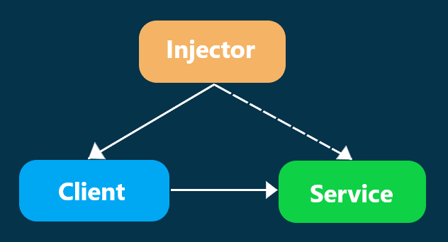
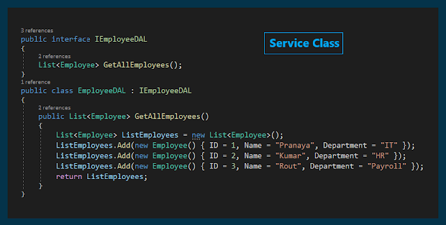
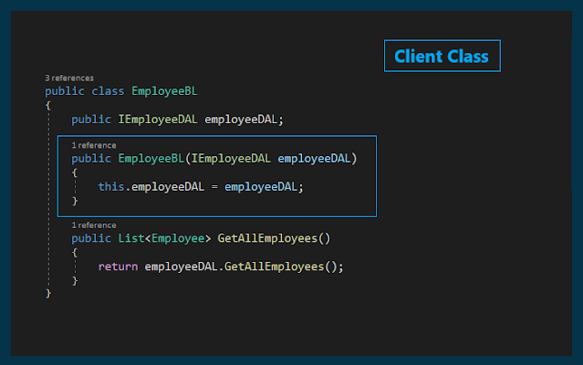
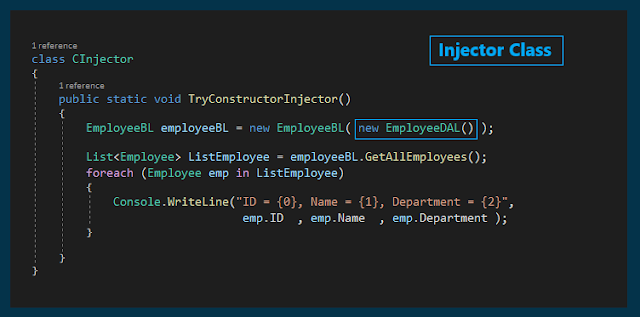
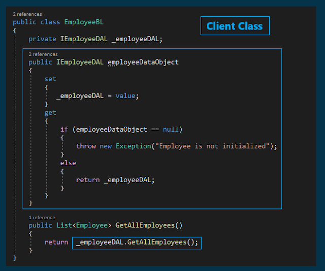
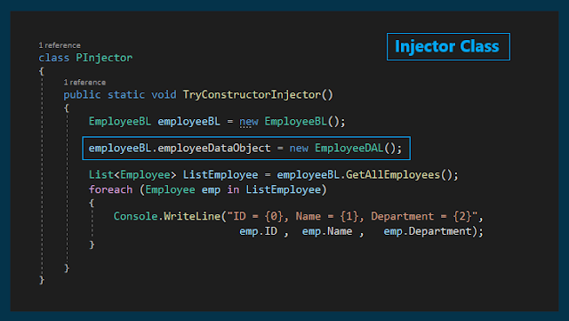
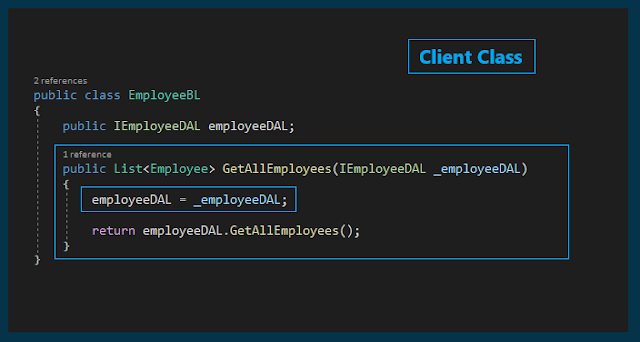
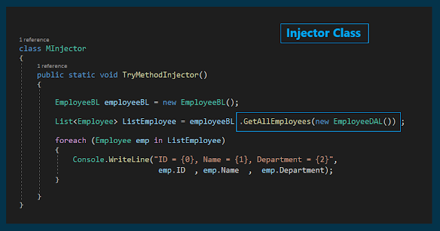

# Dependency Injection Pattern with Examples
## What is Dependency Injection Pattern?
Dependency Injection is a technique where dependencies are provided to a class from the outside rather than created inside it.
### Why it matters:
- Reduces coupling between components
- Improves testability and maintainabilit

## Dependency Injection pattern involves 3 types of classes:

  

### 1- Client Class:
(dependent class) is a class that depends on the service class.

### 2- Service Class:
(dependency) is a class that provides service to the client class.

### 3- Injector Class:
The Injector class injects the service class object into the client class.

## What are Tight coupling and loose coupling

To understand the Dependency Injection Design Pattern, first, we need to understand what is tight coupling and what is loose coupling in software development.
### Tight coupling :  
means classes and objects are dependent on each other.
in other words when a class is dependent on another concrete class. In that case, if we change the dependent object, then we also need to change the classes where this dependent object is used.
If your application is a small one, then it is not that difficult to handle but if you have a big enterprise-level application, then it's really very difficult to handle these changes.
### Loosely coupling:
means two objects are independent of each other. That means
if we change one object then it will not affect another object.
The loosely coupled software development allows us to manage future changes easily and also allows us to manage the complexity of the application.

## What are the advantages of using Dependency Injection?
1. Allows us to develop loosely coupled software components.
2. It is very easy to swap with a different implementation of a component, as long as the new component implements the interface type.

## Different Types of Dependency Injection?
The injector class injects the dependency object into a class in three different ways.
### Constructor Injection:
When the Injector injects the dependency object (i.e. service) through the client class constructor, then it is called Constructor Injection.
### Property Injection:
When the Injector injects the dependency object (i.e. service) through the public property of the client class, then it is called Property Injection. This is also called the Setter Injection.
### Method Injection:
When the Injector injects the dependency object (i.e. service) through a public method of the client class, then it is called Method Injection.

## Implementation
### 1. Constructor Injection:

  
  
  

### 2. Property Injection:

  
  
  

### 3. Method Injection:

  
  
  

