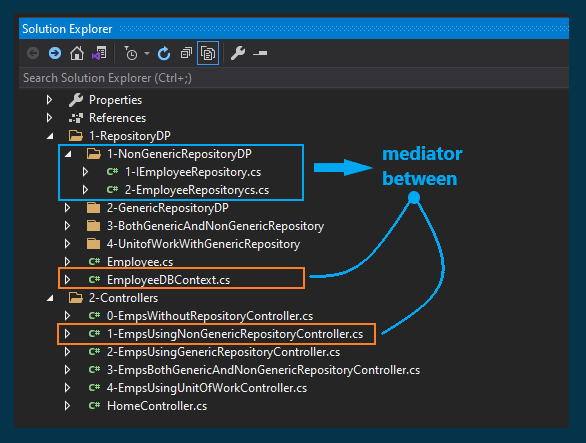
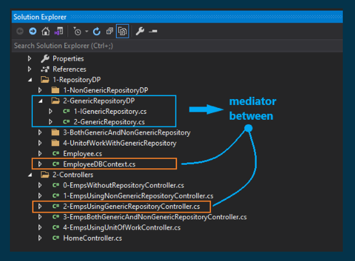
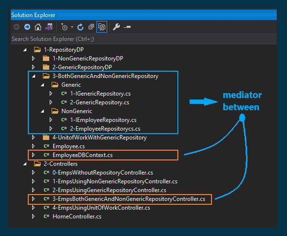
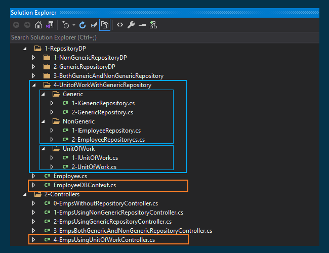

# Repository and Unit of Work Design Patterns

## Introduction

### How does a modern data-driven application access a database?

Most applications need to retrieve and store data from one or more data sources. A common but simplistic approach is to place data access logic directly inside the application—for example, within an ASP.NET MVC controller such as `EmployeeController`, where each action method performs CRUD operations using Entity Framework.

```
   [ Controller ]
        |
        | (Direct access)
        v
[ DbContext / ORM ]
        |
        v
    [ Database ]
``` 


### Drawbacks of this approach

Although this approach works, it introduces several problems. Data access logic becomes tightly coupled to the controller, leading to code duplication and poor maintainability. When multiple controllers require similar operations, the same logic is repeated. As a result, changes must be made in multiple places, increasing the risk of errors and making the system harder to maintain.


## What is the Repository Design Pattern?

The Repository pattern provides an abstraction layer between the business logic and the data access layer. It exposes a collection-like interface for accessing domain objects, helping to decouple the application from the underlying data source.

This separation improves maintainability, testability, and code organization.

```
[ Controller ]
      |
      v
[ Repository Interface ]
      |
      v
[ Repository Implementation ]
      |
      v
[ DbContext / ORM ]
      |
      v
[ Database ]
```


<p align="center">
  
</p>

## Generic Repository Design Pattern

A Generic Repository defines common database operations—such as Create, Read, Update, and Delete (CRUD)—in a single reusable component that works across multiple entities.

```
                        IGenericRepository<T>
                                 |
       -----------------------------------------------------
       |                         |                         |
       v                         v                         v
IGenericRepo<Employee>  IGenericRepo<Product>   IGenericRepo<Customer>
 (same logic)               (same logic)              (same logic)
```

<p align="center">
  
</p>

### Why use a Generic Repository in C#?

In a basic repository implementation, a separate repository is created for each entity (e.g., `EmployeeRepository`, `ProductRepository`, `CustomerRepository`). This leads to repetitive code and violates the DRY (Don’t Repeat Yourself) principle.

A generic repository addresses this issue by consolidating common data access logic into one reusable class.


## Using Both Generic and Non-Generic Repositories

In real-world applications, a generic repository typically handles operations common to all entities (such as CRUD). However, some entities require specialized queries or business logic.

In these cases, a dedicated (non-generic) repository should be created for that entity.

By combining both approaches, you can reuse common functionality while still supporting entity-specific behavior.

```
                         GenericRepository<T>
                                  |
        ------------------------------------------------------
        |                         |                          |
        v                         v                          v
IGenericRepo<Employee>    ProductRepository       IGenericRepo<Customer>
 (no extra logic)        (has extra methods)         (no extra logic)  
                                  |
                                  v
                        GetProductsByCategory()
                        GetTopSellingProducts()
```


<p align="center">
  
</p>

## Unit of Work

The Unit of Work pattern coordinates changes across multiple repositories within a single transaction.

It ensures that all operations are either committed together or rolled back together, maintaining data consistency.


```
                 [ Controller ]
                       |
                       v
                [ UnitOfWork ]
                 /     |     \
                v      v      v
     [EmployeeRepo] [ProductRepo] [OrderRepo]
                \      |      /
                 \     |     /
                       v
               [ DbContext / ORM ]
                       |
                       v
                  [ Database ]
```


### Relationship with Repository Pattern

* The Repository pattern handles data access for individual entities
* The Unit of Work manages transactions across multiple repositories

Together, they provide a clean and consistent data access layer.


### Unit of Work with Generic and Non-Generic Repositories

<p align="center">
  
</p>


