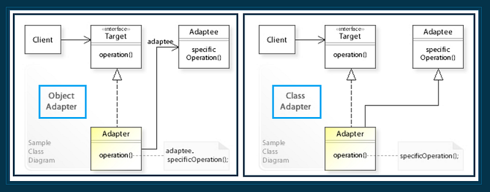
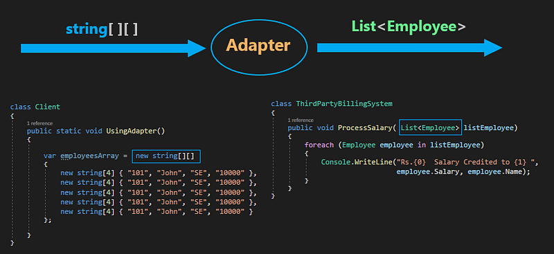
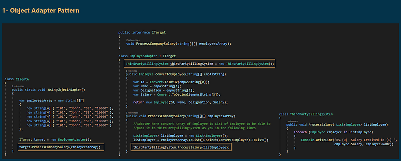
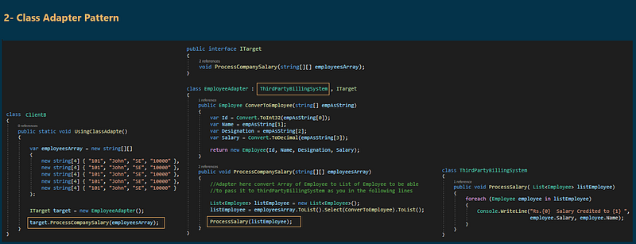

# Adapter Design Pattern with an Example
## What is the Adapter Design Pattern?
The Adapter Design Pattern works as a bridge between two incompatible interfaces. This design pattern involves a single class called adapter which is responsible for communication between two independent or incompatible interfaces.

## Class Diagram of Adapter Design Pattern:

  

As you see the Adapter Design Pattern is composed of four components:
1. **Client**: can only see the Target interface.
2. **Target**: It is an interface and this interface needs to be implemented by the Adapter and the client can see only this interface.
3. **Adapter**: This is a class that makes two incompatible systems work together. The Adapter class implements the Target interface.
4. **Adaptee**: This class contains the functionality which the client requires but it's not compatible with the existing client code.  

And can be implemented in two ways. They are as follows:
1. Object Adapter Pattern
2. Class Adapter Pattern
   
## Understanding the Adapter Design Pattern using an Example:
Please have a look at the following image. On the right-hand side, you can see the `ThirdPartyBillingSystem` and on the left side, you can see the Client. The Client needs to call the `ProcessSalary` method of `ThirdPartyBillingSystem` to process the salary of employees. But if you look at the Client, the employee information is in the form of a string jagged array and the `ProcessSalary` method of the `ThirdPartyBillingSystem` needs employee information in the form of `List<Employee>`. So, the Client cannot call directly to `ThirdPartyBillingSystem` because `List<Employee>` and `string jagged array` are incompatible.

### Solution :
To solve the previous problem we need an adapter between the client and `ThirdPartyBillingSystem`.  

  

Now the Client will send the employee information in the form of a `string jagged array` to the Adapter. then Adapter will read the employee information from the string jagged array and convert it to `List<Employee>` and then the Adapter will send the `List<Employee>` to the `ProcessSalary` method of `ThirdPartyBillingSystem`.

  
    

## When to use the Object Adapter pattern and when to use the Class Adapter Pattern in C#?
If you have a java class and you want to make it compatible with .net class, then you need to use the object adapter pattern and the reason is it is not possible to make inheritance. On the other hand, if both the classes are within the same project and using the same programming language and if the inheritance is possible then you need to go for Class Adapter Pattern.

## When to use the Adapter Design Pattern in the real-time application?
1. When we need to allow communication between a new and already existing system that is independent of each other.
2. When we need to allow a system to use classes of another system that is incompatible with it.
3. Sometimes a toolkit or class library cannot be used because its interface is incompatible with the interface required by an application.
