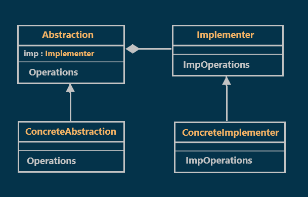
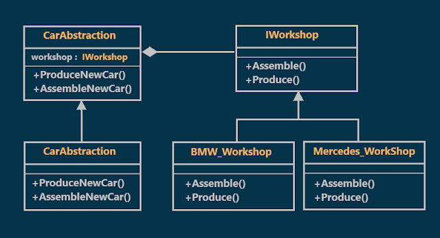
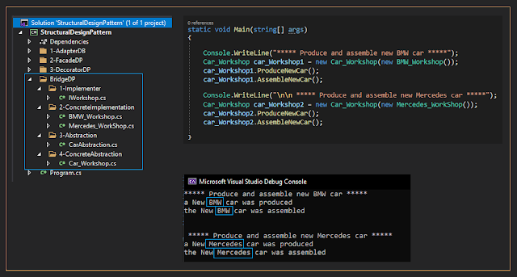

# Bridge Design Pattern with an Example
## What is the Bridge Design Pattern?
As per the GOF definitions, the Bridge Pattern "Decouples an abstraction from its implementation so that the two can vary independently"
In the Bridge Design Pattern, there are two layers.
The first layer is the Abstraction layer
and the second layer is the Implementation Layer.
If I make any changes in the Implementation Layer, then it won't affect the Abstraction Layer.
Similarly, if I make any changes in the Abstraction Layer, then it won't affect the Implementation layer.
## Class Diagram of Bridge Design Pattern:

  

As shown in the previous diagram, the bridge design pattern consists of four components. They are as follows:
### Implementer:
This is an interface that must be implemented by all the implementation classes. This interface is going to act as a bridge between the abstraction class and the implementer class.
### ConcreteImplementationA / ConcreteImplementaionB:
These are classes that implement the Implementor. These classes contain the concrete implementation of all the operations.
### Abstraction:
This is going to be an abstract class. that defines the methods for the client code to call. this abstract class contains a protected implementer variable that holds a reference to the object that performs the implementation.
### ConcreteAbstraction / RefinedAbstraction:
These are classes that are inherited from the Abstraction abstract class.
Understanding Bridge Design Pattern With an Example:
Suppose we want to (produce and assemble) new cars of the following two types (BMW or Mercedes).
to do that we need a workshop for each type to implement the previous two tasks (produce and assemble).
So the class diagram for our example will be like the following:

  

## Implementation :

  

## When do we need to use Bridge Design Pattern in Real-Time Applications?
We need to use the Bridge Design Pattern in Real-Time Applications, when:
1. We want to hide the implementation details from the client.
2. We want the selection or switching of the implementation to be at runtime rather than design time.
3. We want both the abstraction and implementation classes to be extensible by the subclasses.
4. We want to avoid a tight coupling binding between an abstraction and its implementation.
5. The changes in the implementation of an abstraction should have no impact on clients.
