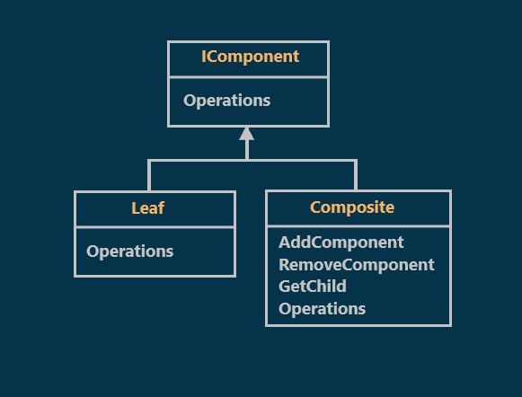
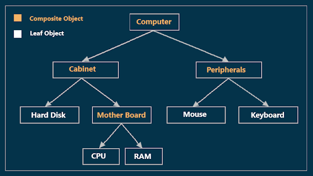
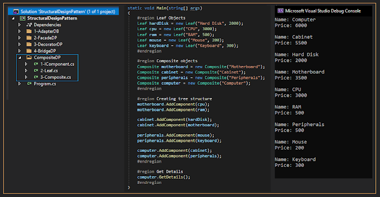

# Composite Design Pattern with an Example
## What is the Composite Design Pattern?
As per the GOF definitions, the Composite Design Pattern states that **"Compose objects into tree structures to represent part-whole hierarchies. Composite let clients treat individual objects and compositions of objects uniformly".**  
The Composite Pattern is used where we need to treat a group of objects in a similar way as a single object.
## Class Diagram of Composite Design Pattern:

  

As shown in the previous diagram, There are three components involved in the Composite Design Pattern. They are as follows:
### Component:
This is going to be an abstract class or interface containing the members that will be implemented by all the child objects in the hierarchy. It also implements some of the behavior that is common to all objects in the composition. This abstract class acts as the base class for all the objects within the hierarchy. In our example, it is the IComponent interface.
### Leafs:
This is going to be a class to represent the leaf behavior in the composition.
### Composite:
The Composite defines the behavior for the components which have children. It also stores its child components and implements Add, Remove, Find and Get methods to do operations on child components.
## Understanding the Composite Design Pattern with an Example:
As we know a computer is made of several parts or elements integrated together as shown in the below diagram.

  

**Computer, Cabinet, Peripherals, Mother Boards** are **composite objects** while **Hard Disk, CPU, RAM, Mouse, and Keyboard** are the **leaf objects**.  
All the above objects have a price. so when you are asking the price for a **Keyboard** you should get the price of the **Keyboard**, But when you are asking the Price for the **Mother Board**, then you should get the sum of **RAM** and **CPU** prices. Similarly, when you are asking the price of the **computer**.
## Implementation:

  

