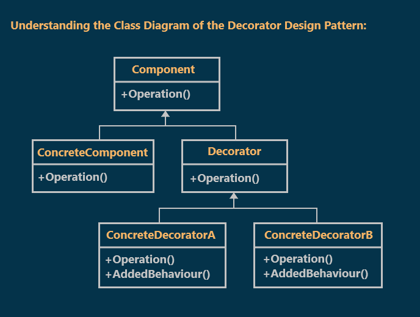
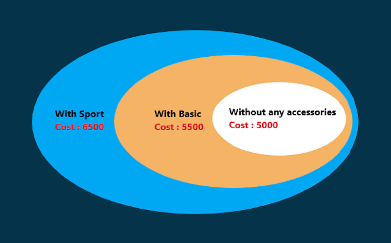
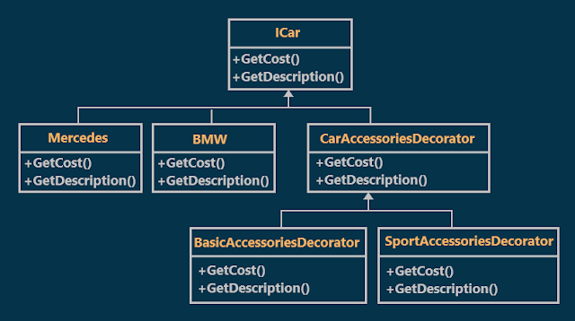
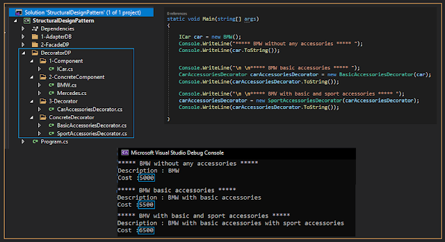

# Decorator Design Pattern with an Example
# What is the Decorator Design Pattern?
The Decorator Design Pattern allows us to dynamically add new functionalities to an existing object without altering or modifying its structure and this design pattern acts as a wrapper to the existing class.
A decorator is an object that adds features to another object.

## Class Diagram of Decorator Design Pattern:
As shown in the previous diagram, four components are involved in the 
Decorator Design Pattern. They are as follows:
### Component:
This is an interface that contains members that are going to be implemented by the concrete component classes and decorator classes.
### ConcreteComponent:
This is going to be a concrete class that will implement the component.
### Decorator:
This is an abstract class. This class implements the Component and contains a reference to a component instance. This class also acts as the base class for all decorators. The decorator is essentially wrapping the Component.
### ConcreteDecoratorA / ConcreteDecoratorB:
These are concrete classes derived from the Decorator. These classes add additional responsibilities to the original component.

  

## Understanding Decorator Design Pattern with an Example :
Suppose we need to build an application for a car showroom that sells cars along with car accessories. Mercedes and BMW come with the optional accessories packages Basic and Sport. So the application must provide the car cost adding the cost of the accessory package if the user chooses any of the preceding packages.
For example, the cost of a BMW car is 5000 but if the user chooses to take the basic accessories the cost will be 5500 and if he chooses to take the sport accessories too the cost will be 6500.

  

### The class diagram depending on our example will be like the following:

  

## Implementation :

  

## Advantages of Decorator Pattern:
1. Adds functionality to existing objects dynamically
2. Alternative to subclassing
3. Flexible design
4. Supports Open Closed Principle
