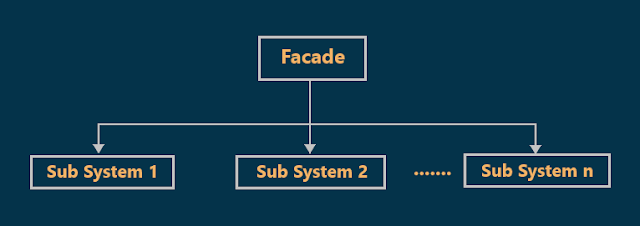
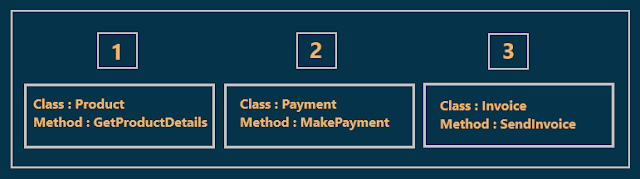
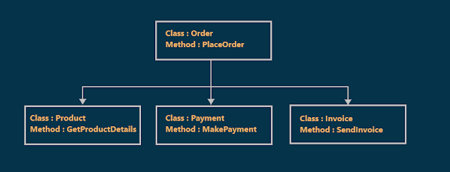
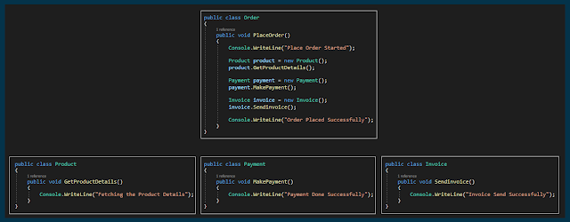

# Facade Design Pattern with an Example
## What is Facade Design Pattern
As per the GOF definition, the Facade Design Pattern states that you need to provide a unified interface to a set of interfaces in a subsystem. The Facade Design Pattern defines a higher-level interface that makes the subsystem easier to use.
## Class Diagram of Facade Design Pattern:

  

As shown in the above image, there are two classes involved in the Facade Design Pattern:
1. The Facade class
2. The Subsystem classes
## Understanding the Facade Design Pattern with one Real-time Example:
we need to design an application to place an order.
### **First without facade:**

  

As shown in the above image, in order to place an order first we need to create an object of Product class and get the product details.
Then if everything is fine then we need to make the Payment by creating an instance of the Payment class and call the MakePayment method.
If Payment is successful then we need to send the Invoice to the customer. So, in order to place the order, we need to do the above mention steps.
### **Second with facade:**

  

The Facade is actually an extra class that lies at the top of the subsystem classes. Please have a look at the following diagram.
So, here the extra class Order is the Facade class which will take the responsibility of placing the order. This class internally creates the instance of the respective classes and calls the method.
## Implementation:

  

When to use Facade Design Pattern in Real-Time Applications?
1. When we want to provide a simple interface to a complex subsystem.
2. When there are many dependencies between clients and the implementation classes.
