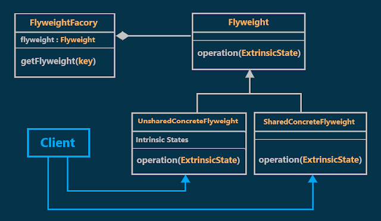
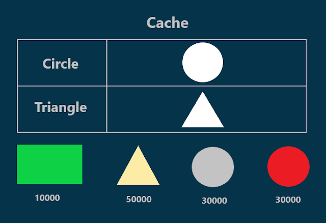
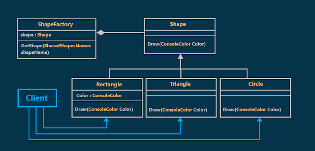
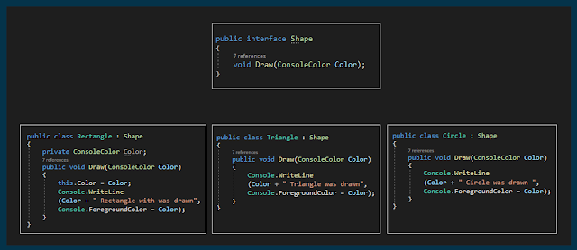
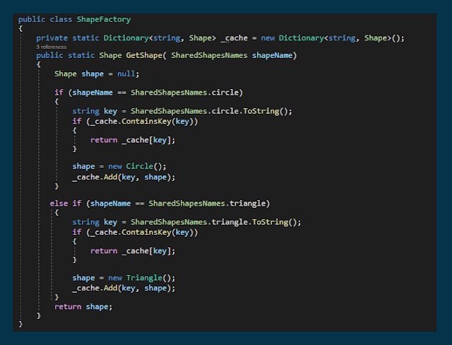
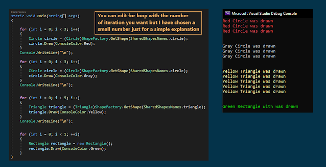

# Flyweight Design Pattern with an Example
## What is the Flyweight Design Pattern?
A flyweight is a shared object that can be used in multiple contexts simultaneously.
The Flyweight Design Pattern is used when there is a need to create a large number of objects of almost similar nature. A large number of objects consumes a large amount of memory and the Flyweight design pattern provides a solution for reducing the load on memory by sharing objects.
## Class Diagram of Flyweight Design Pattern:

  

As shown in the previous diagram, There are three components involved in the Flyweight Design Pattern:
### 1-Flyweight:
Is an interface that defines the members of the flyweight objects, this interface enables sharing, but it doesn't enforce it.
### 2-ConcreteFlyweight (shared or unshared):
#### a-SharedConcreteFlyweight: 
the class which implements the Flyweight interface and adds storage for the **intrinsic state**, if any and must be sharable.
#### b-UnsharedConcreteFlyweight:
the class also implements the Flyweight interface and adds storage for the particular instance and it is not shared.
### 3-FlyweightFacory:
has the GetFlyweight method. this method will check, whether the flyweight object is there in the cache or not. If it is there then it will return that existing flyweight object. And if it is not there, then it will create a new flyweight object and add that object into the cache and return that flyweight object.
## The different States in the Flyweight Design Pattern:
### The intrinsic States:
are things that are constants and stored in memory.
### The Extrinsic States:
are things that are not constants and need to be calculated on the Fly
and are therefore not stored in the memory.
Client objects are responsible for passing **extrinsic state** to the flyweight when it needs it.
## Understanding Flyweight Design Pattern with an Example:
Suppose we have to create 
30000 circle objects with red color, 
30000 circle objects with gray color, 
and 
50000 Triangle objects with yellow color.

### Without Using Flyweight
we will create a new circle or triangle object every time we need one of them and fill it with the needed color which means 30000 circle objects with red color and 30000 circle objects with gray color and 50000 triangle objects with yellow color and this definitely will consume a large amount of memory.
### Using Flyweight
we will create and store one circle object and one triangle object with no color in the Cache. and when we need to create a circle or triangle we can get the object from the cache then using this object we will pass the color we want which means we just need 1 circle object to draw **(30000 circle objects with red color and 30000 circle objects with gray color)** and 1 triangle object to drow **50000 triangle objects with yellow color**.
In our example, the circle and triangle will represent SharedConcreteFlyweight and Rectangle will represent UnsharedConcreteFlyweight.
#### **The following diagram illustrates the solution Using Flyweight:**

  

#### The class diagram for our example:

  

#### **The intrinsic States and the Extrinsic States in our example :**
In our example, the circle and triangle shapes are constants (they are not changed). That means whether the color is changed, the shape of the circle or triangle is going to be the same. So, it is stored in the memory (cache). And as it is stored in the memory and as it is constant, it belongs to the **intrinsic state**.
but the color is not constant and it is calculated on the fly. therefore it is not stored in the memory (cache). As a result, the color belongs to the **extrinsic state**.
## Implementation:

  
  
  

## When to use the Flyweight Design Pattern?
We need to use the Flyweight Design Pattern when
1. Many similar objects are used and the storage cost is high.
2. The majority of each object's state data can be made extrinsic.
3. A few shared objects would easily replace many unshared objects.
