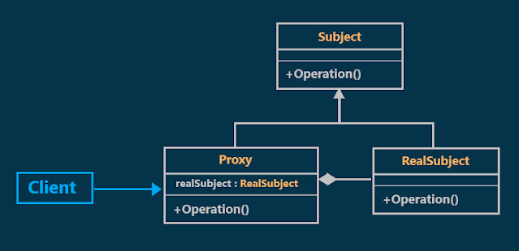
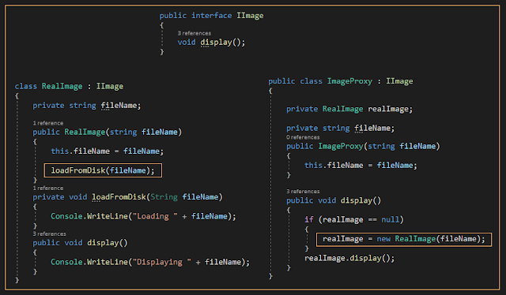
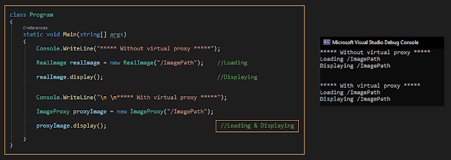
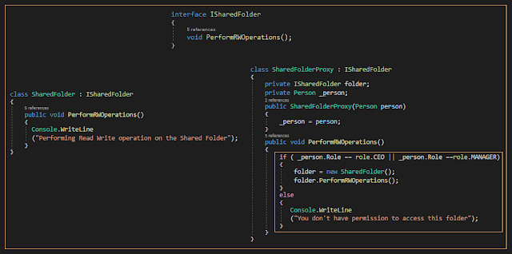

# Proxy Design Pattern with an Example
## What is the Proxy Design Pattern?
According to the GOF definitions, the Proxy Design Pattern provides a surrogate (act on behalf of other) or placeholder for another object to control access to it. Proxy means "in place of" or "representing" or "on behalf of"
## Class Diagram of Proxy Design Pattern:

  

As shown in the previous diagram, there are three components involved in the proxy design pattern. They are as follows:
### 1-Subject:
This is an interface that defines members that are going to be implemented by the **RealSubject** and Proxy class so that the Proxy can be used anywhere the RealSubject is expected.
### 2-RealSubject:
This is a class that we want to use more efficiently by using the proxy class.
### 3-Proxy:
This is a class that holds a reference to the **RealSubject** class and can access **RealSubject** class members as required. It must implement the same interface as the **RealSubject** so that the two can be used interchangeably.  
## Types of proxies
There are three types of proxies. They are as follows:
1. Virtual Proxy:
A virtual proxy is a placeholder for "expensive to create" objects. The real object is only created when a client first requests or accesses the object.
2. Protection Proxy:
A protection proxy might be used to control access to a resource based on access rights.
3. Remote Proxy:
A remote proxy provides local representation for an object that resides in a different address space. for example (ATM)
### 1- Virtual Proxy
#### Understanding Virtual Proxy with an Example:
let's assume we have `RealImage` class that loads and displays photos. `RealImage` class loads the photo even if we did not need to display it, our requirement is to use the virtual proxy to defer loading until the client needs to display it.
#### Implementation:

  
  

### 2-Protection Proxy
#### Understanding Protection Proxy with an Example:
let's assume we have `SharedFolder` class with one method called Perform **RW Operations** our requirement is to control access to this method based on the person's role who wants to access it.
#### Implementation:

  

