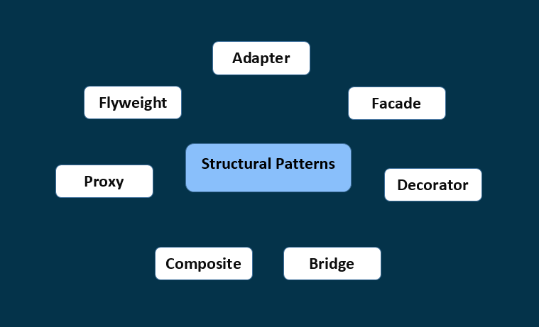

# Structural Design Patterns
## Overview
Structural design patterns are those that simplify the design of large object structures by identifying relationships between them.
They describe common ways of composing classes and objects so that they become repeatable as solutions.

  

# Structural Design Patterns with Examples
1. [Adapter Design Pattern](./AdapterDesignPattern.md)
2. [Facade Design Pattern](./FacadeDesignPattern.md)
3. [Decorator Design Pattern](./DecoratorDesignPattern.md)
4. [Bridge Design Pattern](./BridgeDesignPattern.md)
5. [Composite Design Pattern](./CompositeDesignPattern.md)
6. [Proxy Design Pattern](./ProxyDesignPattern.md)
7. [Flyweight Design Pattern](./FlyweightDesignPattern.md)
